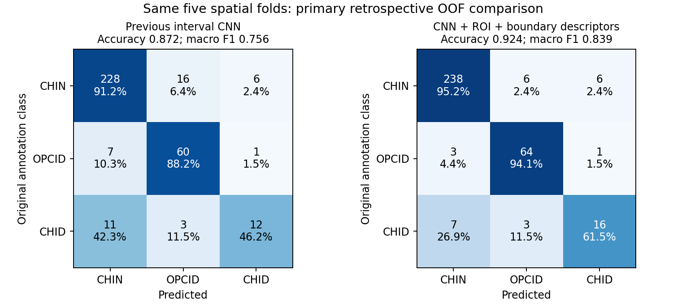
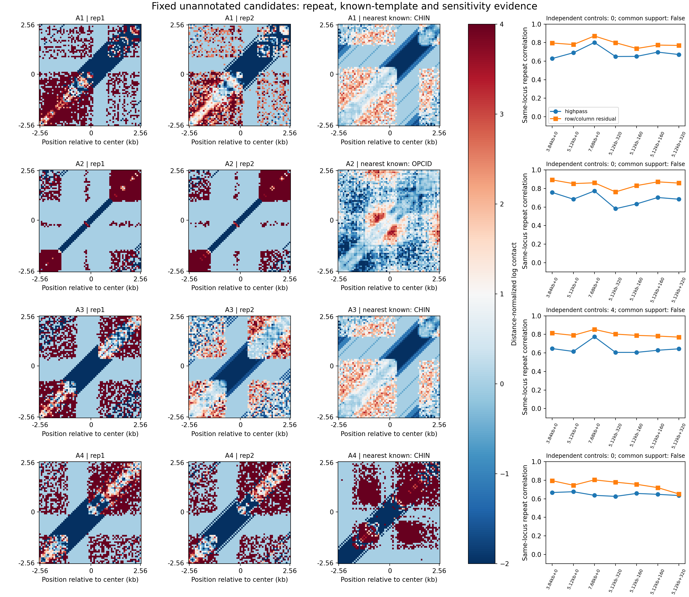
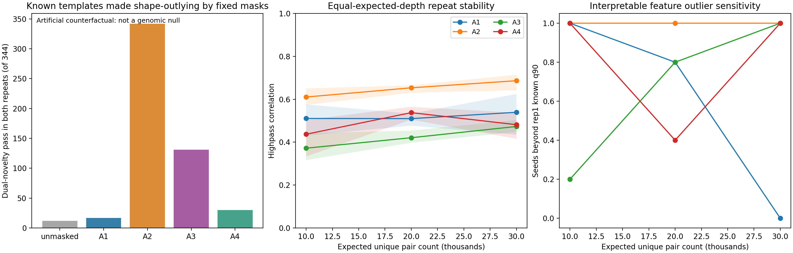
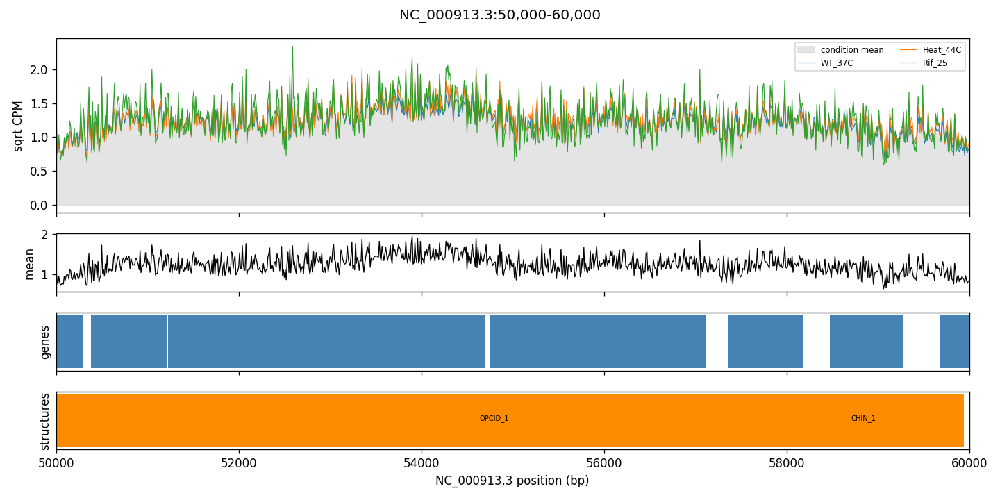
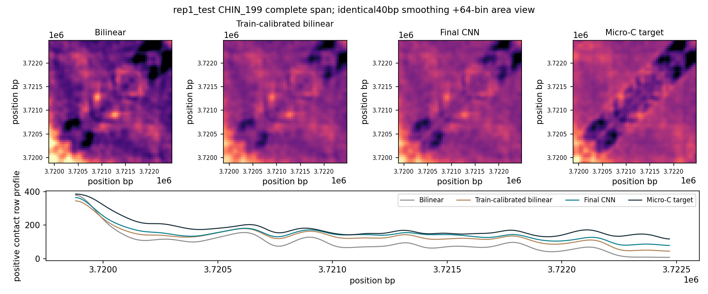
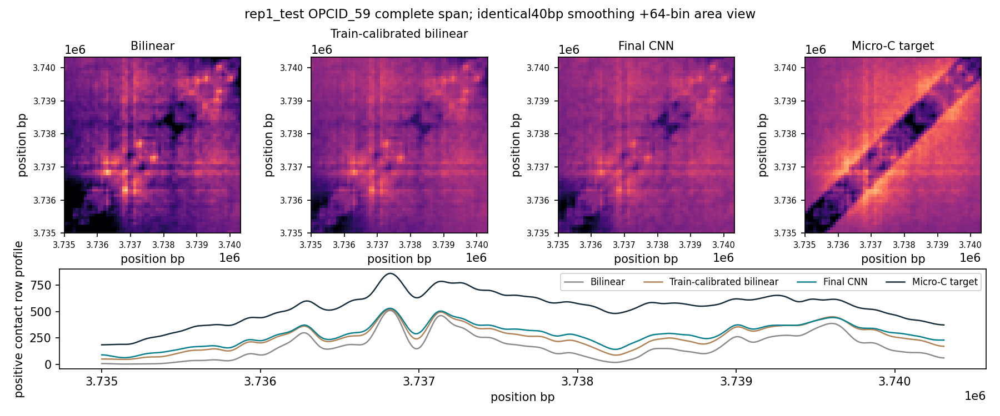
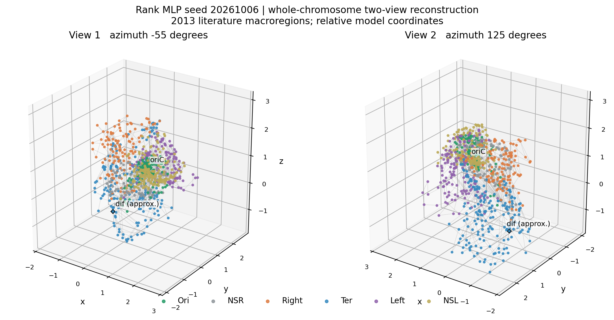

# 基于深度学习的 Micro-C 接触矩阵处理实验报告

本报告汇总六项任务的最终方法、对照与实验结果，更新日期为 2026 年 10 月 14 日。正文以最终实验为准；历史试验和审核原文完整保存在[归档报告](submission/archive/final_verification_20261014/REPORT_before_final_verification.md)。正式排版报告由同一批源表生成，方法与复跑入口见 [METHODS.md](METHODS.md)、[REPRODUCE.md](REPRODUCE.md)。

## 1 实验目标与整体设计

本实验使用大肠杆菌 MG1655 的高分辨率 Micro-C 接触矩阵，围绕“识别局部结构、发现未注释模式、解释条件变化、恢复接触细节与重建整体构象”完成三项必做任务和三项选做任务。各任务共用参考坐标与数据来源，但采用与问题相适应的模型、基线和评价指标：分类以空间交叉预测计分，候选发现以冻结位点的跨重复和质量对照核查，超分辨以完整留出结构比较，三维重建同时检验接触一致性和宏域距离组织。

| 任务 | 最终方法 | 主要对照与评价 |
| --- | --- | --- |
| 1 已知结构识别 | 多尺度 CNN＋已知区间 ROI＋边界描述符 | 40 kb 空间五折、宏 F1、逐类精确率/召回率、消融、双向跨重复测试 |
| 2 未注释候选发现 | 全基因组窗口扫描、计数守恒聚合、形态残差与固定新颖性规则 | 已知结构再发现、第二重复、全量背景、尺度/深度敏感性、覆盖缺口反事实 |
| 3 多轨道可视化 | 连续 10 kb 四面板轨道 | 全长覆盖、统一坐标、图像清单与哈希 |
| 4 条件变化 | 双重复、深度匹配与全部四个跨组比较 | WT 重复波动、三个抽稀种子、稳定交集与位点合并 |
| 5 超分辨 | 完整区间残差 CNN，验证集选定 6 轮纯 CNN | 原始/训练校准插值、PSNR、SSIM、非近对角形态与行轮廓、两重复复核 |
| 6 三维重建 | 环形染色体神经坐标优化与正/零残差排序项 | MDS、等基因组间距接触 AUC、完整文献边界下宏域 AUC、循环位移与文献位点次序 |

## 2 数据与实验设置

参考染色体为 NC_000913.3，长度 4,641,652 bp，原始矩阵分辨率为 10 bp。主分析使用两个 WT 37℃ 重复；条件分析另使用 44℃、利福平及 H-NS 缺失的双重复。已知结构共有 344 条，其中 CHIN 250 条、OPCID 68 条、CHID 26 条。输入下载来源、参考坐标和 SHA-256 记录于[数据来源清单](results/provenance.json)，主输入来自 [NCBI GEO GSE272159](https://www.ncbi.nlm.nih.gov/geo/query/acc.cgi?acc=GSE272159)。

所有低分辨率输入从原始计数聚合得到，插值仅用于构建图像输入。输入和目标分别进行距离归一化，低分辨率输入使用自身统计量。分类中同一注释的两个重复始终留在同一空间折；超分辨的完整输入区间在训练、验证和测试之间不重叠。最终运行记录源码、输入、配置、模型与输出哈希。本项目基于既有标注和测试区，采用回顾性空间留出评价与跨重复复核。具体协议见[分类协议](results/task1_improve_20261006_roi_cnn_seed21_protocol.json)、[超分辨协议](results/task5_full_structure_20261014_final_protocol.json)及[三维几何协议](results/task6_literature_regions_20261014_protocol.json)。

## 3 任务一：已知结构识别

### 3.1 方法与评价

模型使用短、长尺度接触图、已知区间掩膜和区间 ROI，并联接 15 维接触边界/跨度描述符。卷积支路采用 GroupNorm，固定训练 24 轮、两个初始化；类别权重和特征标准化只由训练折拟合。以 40 kb 空间连通组进行五折交叉预测，按结构汇总两重复的输出，报告准确率、宏 F1 和三类指标。全注释训练权重只用于已知起止区间的推理，泛化成绩来自外折预测。[模型与评价来源](results/task1_improve_20261006_evidence_index.json)

### 3.2 结果与解释

| 相同空间五折的对照 | 准确率 | 宏 F1 | CHID 精确率 | CHID 召回率 |
| --- | --- | --- | --- | --- |
| 接触图＋区间 CNN 基线 | 0.872 | 0.756 | 0.632 | 0.462（12/26） |
| 最终 CNN＋ROI＋边界描述符 | 0.924 | 0.839 | 0.696 | 0.615（16/26） |
| 去掉描述符侧支路的消融 | 0.927 | 0.849 | 0.708 | 0.654（17/26） |

最终模型相对 CNN 基线的准确率和宏 F1 配对增益 95% 空间组自助区间分别为 [0.019, 0.095]、[0.014, 0.152]。图像支路消融说明接触图对分类性能具有实际贡献；最终交付保留原定主模型。CHID 类样本较少，增益区间仍较宽。[指标与消融](results/task1_improve_20261006_score_table.csv)、[不确定性与当前模型归因](results/task1_improve_20261006_audit_summary.json)

单源训练的双向跨重复测试中，rep1→rep2 准确率/宏 F1 为 0.9157/0.8353，rep2→rep1 为 0.9070/0.8135，两方向均正确识别 17/26 个 CHID。这表明模型对现有标注具备跨重复可用性。等对角距离、等像素数量的外折遮挡中，CHID 的区间内减分大于区间外减分，配对差为 0.0550，95% 区间 [0.0177, 0.0973]；梯度图与遮挡结果共同展示模型对局部接触信息的依赖。[跨重复结果](results/task1_followup_20261006_transfer_summary.json)、[遮挡源表](results/task1_improve_20261006_oof_occlusion_samples.csv)

本任务完成三类识别、类别级评价、消融和归因展示。区间 ROI 与跨度依赖已知起止点，本模型用于已知区间分类。

## 4 任务二：未注释候选发现与验证

### 4.1 发现规则

全基因组按 5.12 kb 窗口、2.56 kb 步长扫描，共 1,812 个窗口。形态分析以计数守恒聚合和距离归一化为基础，结合自编码器、形态残差与接触密度；候选的新颖性由 rep1 的已知参考标准化、PCA 和最近独立邻居距离阈值定义。单窗口候选和跨位点共同类型分别判定，相邻滑窗合并后按独立位点计数。[发现协议与冻结记录](results/task2_improve_20261006_summary.json)

基础再发现评价中，固定选中的 905 个扫描窗口覆盖 90.1% 的 344 条已知注释；合并为 216 个独立注释区间后，覆盖率为 88.4%，高于保留选窗数量和簇状模式的循环位移基线中位数 77.3% 和第 95 百分位 81.5%。该覆盖率衡量已知结构的再发现能力，支持扫描对已知结构的优先定位。[再发现空间基线](results/task2_known_recall_audit.json)

### 4.2 固定候选结果

| 候选 | 中心坐标（bp） | 原默认规则的双重复新颖性 | 尺度/偏移下高通形态重复相关范围 | 最终定位 |
| --- | --- | --- | --- | --- |
| A1 | 729,600 | 延续 | 0.628–0.801 | 可复现的未注释形态异常候选 |
| A2 | 1,469,440 | 延续 | 0.582–0.774 | 形态异常候选，覆盖缺口混杂突出 |
| A3 | 3,130,880 | 未延续 | 0.605–0.774 | 复现图像但未通过默认新颖性，保留对照 |
| A4 | 1,571,840 | 延续 | 0.626–0.676 | 可复现的未注释形态异常候选 |

固定候选共有四个位点，其中 A1、A2、A4 在两个 WT 重复中延续原默认形态异常判定。候选验证使用完整的 1,103 个不按分数优先筛选的未注释窗口，并按坐标间距取得 333 个独立背景代表；候选数量和门槛保持不变。[候选验证源表与摘要](results/task2_course_verification_20261014_summary.json)

### 4.3 质量对照与结论

尺度检查采用 3.84、5.12、7.68 kb 和 ±160/±320 bp 偏移。共同深度检查采用 10,000、20,000、30,000 个预期非对角上三角计数，每档五个固定种子；全部 344 个已知模板及四候选的两个重复均支持三档深度。匹配量为期望计数，种子间范围展示五种子的最小值至最大值。[共同深度核查](results/task2_course_verification_20261014_qc_complete_common_depth_summary.csv)

将各候选 rep1 的固定零行模式施加于已知模板，并在两重复上使用原冻结规则，未加掩膜时 12/344 个模板越过双重复新颖门槛，A1/A2/A3/A4 掩膜下分别为 17/342/131/30 个。特别是 A2 模式能够强烈诱导“新颖且重复相关高”的评分，说明覆盖缺口需要与真实形态变化分开解释。该人工压力测试用于检查覆盖缺口诱导新颖评分的机制，实际基因组假阳性率仍需真实背景数据估计。[覆盖缺口反事实源表](results/task2_course_verification_20261014_qc_counterfactual_summary.csv)

冻结任务一识别器在临时 5.12 kb ROI 上将四候选均判为 CHIN-like；相同 ROI 的已知 CHID 仅 10/26 与原标签一致，softmax 用于提供已知样式参照，未知类型判定继续依据候选形态和质量证据。[固定分类器参照](results/task2_course_verification_20261014_classifier_summary.json)

本任务完成已知结构再发现、全基因组候选提名及逐候选验证，得到三个可复现的未注释形态异常候选。现有证据没有建立共同的新结构类型：候选之间未形成一致的新颖形态，覆盖匹配背景支持不足，原始 reads 的 MAPQ 与片段覆盖尚未取得。共同类型检验结果与三个候选的逐位点证据一并保留。[最终候选回执](results/task2_course_verification_20261014_final_receipt.json)

## 5 任务三：多轨道可视化

按连续 10 kb 区间生成 465 张四面板轨道图，覆盖整条 4,641,652 bp 染色体。统一展示 WT 37℃、44℃、利福平的深度校正接触强度及条件均值，叠加基因和 CHIN/OPCID 注释。图像使用相同基因组坐标，完整清单记录起止区间、文件大小和 SHA-256；仓库保留代表图，完整图集在本地并可重跑。[逐图清单](results/task3_track_manifest.csv)

连续全长图集同时支持局部结构展示和不同处理的逐区段浏览，完成任务要求的多条件、多注释轨道可视化。

## 6 任务四：条件变化分析

原始计数先聚合，再按共同全局测序深度二项抽稀。每个样本、位点和随机种子使用独立固定随机流，避免文件顺序影响结果。每条变化候选要求全部四个处理－WT 重复组合方向一致，平均效应超过自身重复波动及全体内部重复差异的第 95 百分位；以三个预列种子的交集形成稳定结果，并合并重叠注释为独立位点。

| 处理 | 三种子共有注释 | 合并位点 | 交并比 |
| --- | --- | --- | --- |
| 44℃ | 17 | 12 | 0.378 |
| 利福平 | 98 | 86 | 0.817 |
| H-NS 缺失 | 82 | 64 | 0.626 |

三个处理的共有候选均未发生种子间方向翻转。[44℃/利福平源表与敏感性](results/task4_order_invariant_sensitivity.json)、[H-NS 源表与敏感性](results/task4_hns_sensitivity.json)

本任务给出可定位的处理相关强度变化、双重复热图及稳定性检验。评价对象为归一化非近对角强度变化，采用双重复的探索性筛选规则。H-NS 与 WT 的测序平台/批次差异和处理条件混杂，深度匹配后该混杂仍然存在。[稳定变化清单：44℃](results/task4_heat_stable_changes.csv)、[利福平](results/task4_rif_stable_changes.csv)、[H-NS](results/task4_hns_stable_changes.csv)

## 7 任务五：完整结构的超分辨恢复

### 7.1 最终方法与完整区间评价

以 10 bp Micro-C 模拟 40 bp 低分辨率输入，使用 48 通道、四个残差块的 CNN 和可训练正仿射输出尺度。完整已知区间两侧各保留 160 bp，并对齐 40 bp 网格；推理包含上下文边缘，拼接后全局对称化。训练使用 248 个完整结构，验证 28 个，测试 68 个（CHIN 52、OPCID 10、CHID 6），输入区间不跨集合重叠。

训练损失为 MSE＋0.15×梯度损失＋0.5×局部 SSIM。固定比较 2/4/6 轮和 0.25/0.5/0.75/1.0 的 CNN 比例，仅在验证集选定第 6 轮、比例 1.0 的纯 CNN；模型与选择记录冻结后评估测试和第二重复。对照包含原始双线性/双三次及同训练区拟合两个参数的校准插值，完整保留两重复各 68 个结构。[协议](results/task5_full_structure_20261014_final_protocol.json)、[队列](results/task5_full_structure_20261014_final_cohort_manifest.csv)、[选择冻结](results/task5_full_structure_20261014_final_selection_freeze.json)

### 7.2 图像质量与形态恢复

| 完整区间指标（均值） | rep1 双线性 | rep1 最终 CNN | rep2 双线性 | rep2 最终 CNN |
| --- | --- | --- | --- | --- |
| PSNR（dB） | 12.615 | 13.046 | 12.568 | 13.006 |
| SSIM | 0.0264 | 0.0751 | 0.0253 | 0.0784 |
| 非近对角形态相关 | 0.8398 | 0.8956 | 0.8447 | 0.8989 |
| 正信号行轮廓相关 | 0.9417 | 0.9611 | 0.9415 | 0.9591 |

两个重复各 68/68 个结构的 PSNR、SSIM 和非近对角形态相关均高于原始双线性；行轮廓相关在每个重复中有 75% 的结构改善。PSNR 配对平均增益分别为 0.431 dB（95% 区间 [0.384, 0.475]）、0.439 dB（[0.396, 0.477]）；SSIM 增益分别为 0.0487（[0.0420, 0.0539]）、0.0531（[0.0458, 0.0587]）。区间按 41 个重叠连通结构组进行 2,000 次成对自助重采样。[完整结果与不确定性](results/task5_full_structure_20261014_final_summary.json)、[rep1 逐结构结果](results/task5_full_structure_20261014_final_rep1_test.csv)、[rep2 逐结构结果](results/task5_full_structure_20261014_final_rep2_fixed_test.csv)

相对训练校准双线性，最终 CNN 的 PSNR/SSIM 仍分别提高 0.0780/0.0184（rep1）和 0.0722/0.0190（rep2），形态和轮廓均值也进一步提高，说明结果不仅来自整体尺度调整。[各方法与类别汇总](results/task5_full_structure_20261014_final_method_type_summary.csv)

最终模型稳定改善完整区间图像质量，并支持 CHIN/OPCID 的主要非近对角形态与接触轮廓恢复，CHID 补充结果同样保留。OPCID 细近对角增强带和稀疏高分辨率像素的恢复程度有限，峰定位增益区间跨零。本文统一报告完整区间指标，实验输入为模拟低分辨率 Micro-C；真实 Hi-C 跨技术泛化留待独立输入检验。[136 个完整预测与图像清单](results/task5_full_structure_20261014_final_all_case_manifest.json)、[导出独立核算](results/task5_full_structure_20261014_final_export_receipt.json)

## 8 任务六：整体三维构象重建

### 8.1 模型与整体评价

全染色体按 5 kb 聚合为 929 个 bin，末 bin 对应 1,652 bp。模型由 rep1 拟合，以环形间距去趋势的正接触残差构建目标距离，结合完整循环链连续性和等间距正/零残差排序项；不使用 MDS 预训练或坐标锚定。三个预列随机种子全部保留，主图固定使用首个种子。[冻结模型协议](results/task6_controlled_followup_20261006_protocol.json)

| 固定模型 | rep2 等间距接触 AUC | rep2 正接触 Spearman | 四宏域距离 AUC | 宏域循环位移 BH q |
| --- | --- | --- | --- | --- |
| seed 20261006 | 0.8044 | 0.6958 | 0.6722 | 0.2446 |
| seed 20261007 | 0.8048 | 0.6939 | 0.7171 | 0.1137 |
| seed 20261008 | 0.7995 | 0.6880 | 0.7550 | 0.1177 |
| 同目标 MDS | 0.7813 | 0.2207 | 0.6390 | 0.1137 |
| 简单基因组圆环 | — | — | 0.5000 | — |

三个种子在 rep2 的匹配接触 AUC 和正接触相关均高于同目标 MDS；正接触相关相对不加排序项的神经对照略有降低，说明接触强度拟合与减少不合理近邻之间存在取舍。[接触独立重算](results/task6_full_geometry_20261014_rep2_reverification.csv)

### 8.2 文献坐标与几何解释

宏域采用 Zarei 等 2013 年补充表 1 的完整边界版本：Ori 为 3.76–0.05 Mb，跨越坐标零点；NSR 0.05–0.60、Right 0.60–1.21、Ter 1.21–2.18、Left 2.18–2.88、NSL 2.88–3.76 Mb。边界以原文两位小数 Mb 转录，约有 10 kb 精度，作为文献尺度参考。主分析使用四个结构化宏域并排除边界 ±50 kb，同/异域 bin 对在完全相同的环形基因组间距内匹配；全部六区、无边界裁剪及另一近似版本保留为敏感性分析。[文献坐标来源与转录](results/task6_literature_regions_20261014_protocol.json)、[完整边界表](results/task6_literature_regions_20261014_literature_boundaries.csv)

三种子整体四宏域 AUC 均超过 MDS，Ori 单域 AUC 为 0.881–0.923，显示宏域相关的整体距离组织和较强 Ori 聚集。各单域的聚集强度有所差异，Left、Ter 和 Right 仍有种子差异；循环位移多重校正后没有 q<0.05。因此整体结构趋势与独立于位置的严格统计特异性分开报告。[整体几何源表](results/task6_literature_regions_20261014_macrogeometry.csv)、[单域源表](results/task6_literature_regions_20261014_individual_domains.csv)

文献描述的 Ori4（9.9 kb）至 NSR5（515 kb）比至 Right2（738 kb）更近的次序，在三个种子和 MDS 中均复现；oriC 按官方 GFF 定位，dif 标为约 1.604 Mb。该次序与跨零点 Ori 共同用于几何解读，作为文献位点关系的比较参照。三维解表示接触约束下的相对构象，旋转、镜像和绝对尺度不唯一。[位点与坐标标记](results/task6_literature_regions_20261014_coordinate_labels.csv)、[几何核查](results/task6_full_geometry_20261014_summary.json)

本任务完成整体构象、接触基线比较、文献边界及位点关系检查，支持宏域相关整体组织。最终坐标为接触约束下的相对几何表示。[最终几何回执](results/task6_literature_regions_20261014_final_audit.json)

## 9 加分项：清晰可视化与大语言模型辅助发现

候选展示采用双重复热图、尺度/深度敏感性和覆盖缺口反事实，把位置、形态、数值与解释放在同一证据链上；超分辨使用相同颜色范围、相同显示尺度和行轮廓比较；三维图同时给出两个固定视角、宏域、跨零点 Ori、oriC 与 dif。每幅图绑定原始源表或图像清单，而非只展示最优样本。

大语言模型参与候选证据整理、反事实检查设计、代码实现与结果解读。模型建议已落实为可运行的覆盖缺口和固定分类器检查，并由实际数据输出核验，候选结论以实际形态和质量对照为依据。离线辅助标注界面支持双重复查看、人工备注和 JSON 导出，供后续人工核查。[候选程序与实际结果回执](results/task2_course_verification_20261014_final_receipt.json)、[当前结果判定](results/final_verification_20261014_assessment.json)

## 10 总结与提交信息

六项任务均形成完整的方法、代码、结果和评价链：已知区间分类达到 92.4% 准确率及 0.839 宏 F1；发现三个双重复延续的未注释形态异常候选并完成质量核查；生成全长多轨道图与三种处理的稳定变化清单；超分辨在两重复全部 68 个完整结构上改善主要图像/形态指标；三维重建的匹配接触 AUC 和完整文献边界下整体宏域 AUC 均超过 MDS。

各项结果同时呈现其主要发现与检验范围：任务二验证三个形态异常候选，共同新类型尚未建立；任务五主要形态和轮廓恢复稳定，细带与峰位仍有改进空间；任务六给出接触约束下的相对构象，单域效果有所差异。最终判定与证据入口记录于 [AUDIT.md](AUDIT.md) 和[最终结果判定](results/final_verification_20261014_assessment.json)，复跑按 [REPRODUCE.md](REPRODUCE.md) 进行。

组号、姓名、学号及真实分工/贡献比例由小组补填，不编造身份或贡献；讲解视频及课程平台正式提交仍由小组完成。
